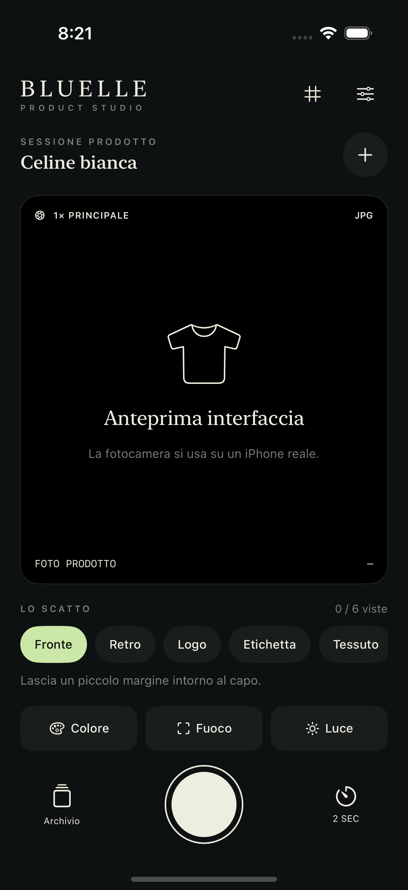
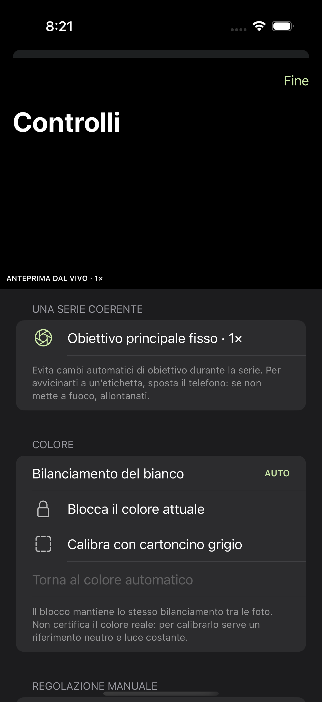
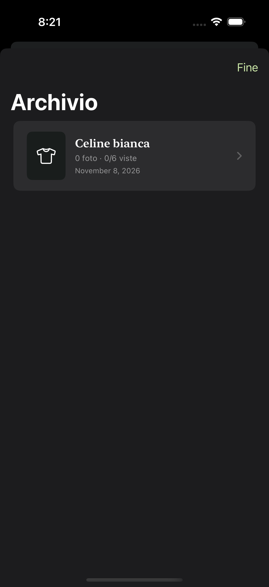

# BLUELLE Studio

## Versione web per iPhone

**[Apri BLUELLE Studio](https://popi99999.github.io/BLUELLE-Studio/)** in Safari, poi **Condividi → Aggiungi alla schermata Home**. Se compare, lascia attivo **Apri come app web**. Per questa versione non serve Xcode.

Aggiungi l’app alla Home prima di creare l’archivio: Safari e l’app sulla Home possono usare archivi separati.

La versione web in `web/` apre la fotocamera di sistema con un input di acquisizione, conserva i byte dei file ricevuti in IndexedDB e organizza le foto per prodotto. Offre correzione di esposizione, temperatura/tinta e riferimento neutro dopo lo scatto, con preset per sessione; esporta file ricevuti o JPEG corretti alla dimensione decodificata dal browser. Le foto con trasparenza usano un fondo bianco nelle anteprime e nei JPEG corretti. Importazioni multiple possono essere riclassificate con il selettore sotto le anteprime.

I controlli web non accedono a RAW, fuoco manuale, ISO o blocco del bilanciamento del sensore su Safari. Nessun controllo hardware non disponibile viene simulato. Il formato e la risoluzione consegnati dalla fotocamera sono decisi da iOS/browser; HEIC e immagini molto grandi possono avere limiti di anteprima/esportazione. Il file ricevuto resta esportabile anche quando il browser non riesce a mostrarne l’anteprima.

Foto e regolazioni rimangono sul dispositivo; non vengono caricate su GitHub o su altri server. Esporta regolarmente una copia: la cancellazione dei dati del sito o la liberazione di spazio da parte del browser possono rimuovere l’archivio. Dopo il primo caricamento completo, il service worker conserva l’interfaccia per l’uso offline. Gli aggiornamenti web devono incrementare il nome cache in `web/sw.js`.

La pubblicazione è gestita da `.github/workflows/pages.yml`, con sorgente GitHub Pages impostata su **GitHub Actions**. Verifica web: `node --test web/tests/*.test.mjs`; anteprima locale: `python3 -m http.server 8767 --directory web`.

Riferimenti: [app sulla Home di iOS](https://webkit.org/blog/13878/), [configurazione web app Apple](https://developer.apple.com/library/archive/documentation/AppleApplications/Reference/SafariWebContent/ConfiguringWebApplications/ConfiguringWebApplications.html), [Image Capture API](https://developer.mozilla.org/en-US/docs/Web/API/ImageCapture).

## App nativa per iPhone

Fotocamera nativa per iPhone dedicata a prodotti moda: una serie coerente di foto del capo, del logo, delle etichette e dei dettagli.

**Prima versione da provare su un iPhone reale.** I controlli sul nucleo sono eseguibili sul Mac; la build iOS e le schermate del simulatore sono verificate dal workflow GitHub Actions. Un simulatore non può verificare messa a fuoco, colori o RAW di una fotocamera fisica. Non è stata misurata una percentuale di miglioramento rispetto a Fotocamera Apple.

<p>
  
  
  
</p>

Anteprime reali dal simulatore: il riquadro nero sostituisce la fotocamera fisica, senza simulare scatti. Il workflow GitHub Actions compila l’app, esegue i 32 controlli sul nucleo e due prove dell’interfaccia (creazione, controlli, archivio, rinomina e cancellazione).

## Cosa include

**Scatto**
- Obiettivo posteriore principale fisso a 1×, senza zoom digitale o passaggi automatici al macro.
- Foto salvate dritte anche con il telefono in orizzontale. Nelle foto dall’alto resta l’ultimo orientamento.
- Scatto dal pulsante, dai **tasti volume** o dal Controllo fotocamera (iOS 17.2 o successivo), timer 0/2/5/10 secondi.

**Fuoco**
- Tocco per mettere a fuoco e misurare la luce in quel punto. Quando la scena cambia, l’app torna all’autofocus continuo al centro: un tocco su un’etichetta non lascia sfocato lo scatto successivo.
- Blocco del fuoco e **fuoco manuale** con cursore, utile su un supporto per etichette e loghi.
- **Peaking**: evidenzia in verde i contorni nitidi nell’anteprima.

**Luce**
- Esposizione automatica con compensazione EV e blocco.
- **Esposizione manuale**: ISO e tempo, con esposimetro in EV.
- **Istogramma** dal vivo e avvisi per bianchi bruciati e neri chiusi. **Zebra** colora in rosso le zone bianche senza dettaglio.

**Colore**
- Blocco del bilanciamento del bianco, temperatura e tinta manuali, calibrazione con cartoncino grigio neutro. Anteprima dal vivo anche nei controlli.

**Composizione**
- Griglia dei terzi.
- **Livella**: linea dell’orizzonte con il telefono davanti al capo, inclinazione avanti/indietro, bolla per le foto dall’alto. Diventa verde entro 1°.
- Indicazioni basate su ISO, tempo, stato del fuoco e giroscopio. Sono avvisi sul rischio di mosso, **non punteggi di nitidezza**, misure di colore o garanzie di resa.

**File**
- JPEG qualità 95 % alla massima risoluzione del formato attivo, con la massima priorità di dettaglio di iOS. Le dimensioni effettive vengono registrate per ogni scatto.
- **Apple ProRAW** (DNG) alla piena risoluzione sugli iPhone che lo supportano, con la fusione multi-scatto di iOS. Sugli altri, RAW Bayer a scatto singolo quando disponibile.
- Nomi leggibili, per esempio `Celine-bianca_03_etichetta.jpg`. Un file esistente non viene mai sovrascritto.

**Archivio**
- Sessioni per prodotto con sei viste: fronte, retro, logo, etichetta, tessuto e difetti. Una vista già scattata può essere ripetuta.
- Visualizzazione con zoom, cancellazione di singole foto o di un prodotto con conferma, rinomina.
- Condivisione degli originali, aggiunta a Foto di una foto o di tutto il prodotto.

Non applica ritocchi generativi, rimozione di difetti, saturazione automatica o ricostruzione dei loghi. I dati JPEG/DNG restituiti da AVFoundation vengono conservati senza ricodifica. Le anteprime nell’archivio sono ridotte solo per la visualizzazione, al massimo 4096 pixel sul lato lungo, per non esaurire la memoria con le foto da 48 MP.

### Rispetto a Fotocamera Apple

| | Fotocamera Apple | BLUELLE Studio |
|---|---|---|
| Obiettivo | Può passare da solo al grandangolo o al macro | Sempre il principale 1× |
| Colore tra le foto | Cambia a ogni scatto | Bloccabile e calibrabile con cartoncino grigio |
| Esposizione | Automatica, con compensazione | Automatica o manuale (ISO e tempo), istogramma, zebra |
| Fuoco | Automatico, blocco con pressione lunga | Automatico, punto, blocco o manuale con peaking |
| RAW | ProRAW sui modelli Pro | ProRAW sui modelli Pro, RAW Bayer sugli altri quando disponibile |
| Archivio | Mescolato al rullino | Sessioni per prodotto con le sei viste |

L’iPhone è lo stesso e il JPEG resta elaborato da iOS. Il vantaggio è il controllo e la costanza tra le foto, non un sensore diverso. Non è stata ancora misurata la resa su un iPhone reale: vedi la prova su iPhone.

## Aprire sull’iPhone

Richiede **iOS 17 o successivo**, un Mac con Xcode e un iPhone collegato. Nessuna libreria esterna è necessaria per l’app.

1. Scarica o clona il repository.
2. Apri `BluelleStudio.xcodeproj` in Xcode. Il progetto generato è già incluso.
3. In **Signing & Capabilities**, seleziona il tuo Team Apple; modifica l’identificatore del bundle se Xcode lo richiede.
4. Seleziona l’iPhone come destinazione ed esegui **Run**. Segui le eventuali richieste di iOS per l’esecuzione delle app di sviluppo.

GitHub contiene il codice sorgente: non è un link di installazione TestFlight o App Store. L’artefatto di CI è per il **simulatore**, non installabile su un telefono.

Per rigenerare il progetto dopo modifiche a `project.yml`:

```sh
brew install xcodegen
xcodegen generate
```

## Una sessione consigliata

1. Pulisci la lente, prepara luce diffusa e costante e crea il prodotto con `+`.
2. In **Controlli**, inquadra un cartoncino grigio neutro al centro per almeno metà fotogramma. Attendi che l’anteprima sia stabile, poi calibra e blocca. Senza cartoncino puoi bloccare il colore attuale, ma non verificarne la fedeltà.
3. Metti il telefono su un supporto e raddrizzalo finché la livella è verde. Per un capo bianco abbassa l’esposizione finché Zebra non colora più le zone con trama; per un capo nero controlla l’avviso dei neri chiusi.
4. Con il treppiede, passa all’esposizione manuale: ISO al minimo e tempo più lungo. Scatta con il timer o con i tasti volume.
5. Scatta il fronte. Mantieni la stessa luce per il retro e i dettagli.
6. Per le etichette, tieni telefono e tessuto paralleli: tocca il testo, oppure usa il fuoco manuale con Peaking. Se sei troppo vicino, allontanati: il principale ha una distanza minima di messa a fuoco (indicata in Controlli) e non passa automaticamente al macro.
7. Controlla le foto ingrandite nell’archivio. Elimina quelle venute male o ripeti la vista.
8. Esporta da Archivio. Il sistema di condivisione riceve i file integri; app di messaggistica o piattaforme esterne possono comprimerli successivamente.

La luce, il riferimento neutro, la distanza e la stabilità rimangono determinanti. Un DNG richiede sviluppo in un editor (Lightroom, Foto, Darkroom); non equivale a un JPEG già corretto. Un ProRAW a 48 MP pesa circa 75 MB.

## File e privacy

- Nessun server, login applicativo, analytics o invio automatico di immagini.
- Ogni prodotto ha una cartella UUID e un `product.json` nella directory Documenti dell’app, visibile in **File → Sul mio iPhone → BLUELLE Studio**.
- I file vengono scritti prima di aggiornare atomicamente il manifest. Una scrittura fallita non viene conteggiata come foto riuscita.
- Per eliminare una foto, prima la si toglie dal manifest e poi si cancellano i file: l’archivio non elenca mai una foto mancante.
- Un manifest illeggibile viene segnalato senza nascondere gli altri prodotti. I relativi file restano sul dispositivo per il recupero.
- La fotocamera è l’unico accesso chiesto all’avvio. Il sensore di movimento serve solo per livella, orientamento e avvisi di mosso, senza permessi aggiuntivi. L’autorizzazione ad aggiungere a Foto viene chiesta solo premendo **Aggiungi a Foto**. L’app non legge la libreria Foto esistente.
- Non raccoglie la posizione. I normali backup e le funzioni di condivisione del sistema restano gestiti da iOS e dall’utente.
- Nessuna foto personale della libreria usata come riferimento è inclusa nel repository.

## Verifica

```sh
swift run StudioCoreChecks
```

Il runner senza dipendenze esegue 32 controlli: limiti del bilanciamento, avvisi di acquisizione, livella e orientamento dello scatto, scala dei tempi manuali, istogramma/zebra/peaking su fotogrammi sintetici, round trip del manifest, byte degli originali conservati, coppia JPEG/RAW, nomi dei file, cancellazione e rinomina, errori di salvataggio e recupero di sessioni sane accanto a manifest danneggiati.

Con Xcode:

```sh
xcodebuild test -project BluelleStudio.xcodeproj -scheme BluelleStudio \
  -destination 'platform=iOS Simulator,name=iPhone 16' CODE_SIGNING_ALLOWED=NO
```

Adatta il nome al simulatore installato. Il workflow `.github/workflows/ios.yml` sceglie automaticamente un iPhone disponibile, esegue lo smoke test dell’interfaccia e conserva app del simulatore, screenshot e risultato XCTest come artefatto. La modalità `--ui-testing` disabilita la fotocamera e non genera foto finte.

Per validare l’hardware, segui [la prova su iPhone](docs/device-validation.md).

## Riferimenti Apple

- [Priorità qualità foto](https://developer.apple.com/documentation/avfoundation/avcapturephotosettings/photoqualityprioritization).
- [Dimensioni massime e formato attivo](https://developer.apple.com/documentation/avfoundation/avcapturephotooutput/maxphotodimensions).
- [Cartoncino neutro e gray-world gains](https://developer.apple.com/documentation/avfoundation/avcapturedevice/grayworlddevicewhitebalancegains).
- [Limiti e completamento del blocco bilanciamento](https://developer.apple.com/documentation/avfoundation/avcapturedevice/setwhitebalancemodelocked(with:completionhandler:)).

